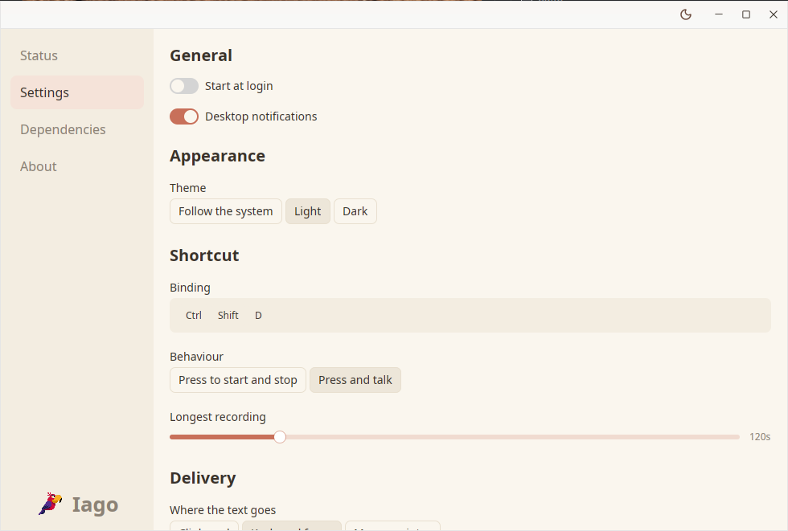
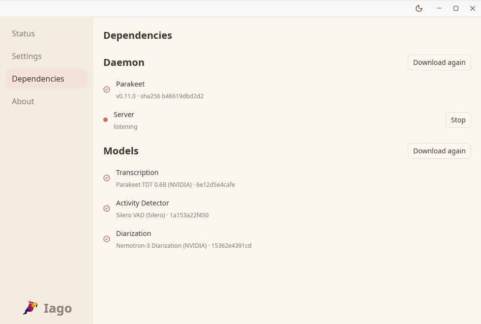

<div align="center">
  
</div>

<br>

## Table of Contents

- [What it is](#what-it-is)
- [Features](#features)
- [Requirements](#requirements)
- [Install](#install)
- [Using it](#using-it)
- [Built on Parakeet](#built-on-parakeet)
- [Development](#development)
- [Contributing](#contributing)
- [Licence](#licence)

## What it is

Iago is a desktop app for dictation. You keep the window in the background, hold a
key combination, say what you want to write, and let go. Seconds later the text is
in the box you had focused, or in the clipboard if you prefer.

The speech recognition runs locally, so nothing leaves the machine.

Linux today. macOS next.

Sorry about that. I would rather test everything until it is good than ship
something that is not quite there.

<div align="center">
  
  
</div>

## Features

- 25 European languages, on NVIDIA's Parakeet models.
- Push to talk, or press once to start and again to stop.
- The text goes where you were writing, or to the clipboard.
- Linux today. macOS next.
- A tray icon, so the window does not need to stay open. Coming too.

## Requirements

### Linux

- Wayland.
- PipeWire.
- Vulkan.
- A desktop with the `GlobalShortcuts` portal: GNOME, KDE Plasma, Hyprland.
- Rust 1.85 or newer, only to build from source.

### macOS

Coming soon.

## Install

Download the tarball for your architecture from the
[releases page](https://github.com/achetronic/iago/releases) and unpack it:

```sh
tar xzf iago-0.1.0-linux-amd64.tar.gz
cd iago-0.1.0-linux-amd64
```

Start it:

```sh
./iago
```

The window opens and starts the daemon next to it, so the shortcut and the
paste are ready. Before the first dictation, go to **Dependencies** and download
the models.

To have it start with your session, add `iago daemon run` to your desktop's
startup applications, or turn on autostart in **Settings**.

### Desktop entry

A `.desktop` file is what puts Iago in the app menu, so it can be launched with
a click. Building from source with `make install` installs the binary, the
desktop entry and the icon, and that is the easy path. The tarball ships the
same two files next to the binary; install them by hand with:

```sh
install -Dm755 iago ~/.local/bin/iago
install -Dm644 com.achetronic.Iago.desktop \
  ~/.local/share/applications/com.achetronic.Iago.desktop
install -Dm644 com.achetronic.Iago.svg \
  ~/.local/share/icons/hicolor/scalable/apps/com.achetronic.Iago.svg
sed -i "s|^Exec=.*|Exec=$HOME/.local/bin/iago|" \
  ~/.local/share/applications/com.achetronic.Iago.desktop
update-desktop-database ~/.local/share/applications 2>/dev/null || true
```

The entry itself is this:

```desktop
[Desktop Entry]
Type=Application
Name=Iago
GenericName=Dictation
Comment=Private, local dictation powered by Parakeet
Exec=/home/you/.local/bin/iago
Icon=com.achetronic.Iago
Terminal=false
Categories=Utility;
Keywords=dictation;speech;transcription;
StartupNotify=true
```

`Exec` must be the absolute path to the binary. The `GlobalShortcuts` portal
matches the running process against the installed entries to name the app, so a
wrong path leaves push-to-talk undelivered.

After that, clicking the icon opens the window and starts the daemon, so the
shortcut and the paste are ready.

## Using it

Open Iago and go to **Dependencies**. One click downloads the models it needs to
transcribe.

Then open **Settings** and tell it how to behave: which keys, held or toggled, and
where the text goes, into the box you were writing in or to the clipboard.

Press the shortcut, speak, and let go.

## Built on Parakeet

Iago's recognition is based on [Parakeet](https://github.com/achetronic/parakeet),
an ASR server written in Go that runs NVIDIA's Parakeet TDT 0.6B model with ONNX
Runtime. Iago runs it next to itself with the models you downloaded, and talks to
it over HTTP.

If you already have a Parakeet server somewhere else, on a container or on a bigger
machine, Settings lets you point Iago at it instead.

## Development

```sh
make            # every target, with a line each
make check      # formatting, lints and tests; what CI runs
make install    # build and install into ~/.local
make dist       # release tarball for this machine
```

## Contributing

Found a bug, or a behaviour that makes no sense? Open an issue and describe it:
what you did, what happened, what you expected. Discussion first, always.

Then, if you want to write the fix:

1. Fork the repository.
2. Create a branch for your change.
3. Open a pull request that references the issue.

Small pull requests are easier to review than large ones, and a change that comes
with the reasoning behind it lands faster than one that does not.

## Licence

Apache-2.0.
